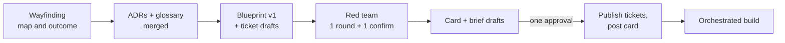

# Blueprint

A **blueprint** is the build plan between the decisions and the build. It reads the ADRs and the glossary, and gives four drafts. The human approves all four in one sitting. Nothing goes to the tracker before that approval.

1. The blueprint document: mental model, hard constraints, build tickets, proof of done.
2. The ticket drafts, with their blocked-by graph.
3. The mission card.
4. The orchestrator brief.

The blueprint plans. It writes no product code. When the blueprint shows that a decision is missing, the decision goes back to its owner and into an ADR, not into a ticket.

## Steps

### 1. Fix the scope and the inputs

Resolve the project, the repo, the vault (AGENTS.md Output directory), the tracker and the mission's parent ticket together, before you write anything. All files go in one vault folder: `<YYYY-MM-DD>-<PARENT-ID>-<slug>-blueprint/`.

Read the repo's `GLOSSARY.md`, the ADR index and every ADR in the area. If a wayfinding map exists, read its Destination, Decisions so far, open child tickets, Not yet specified and Out of scope. Follow the links of the resolved decisions that define the build outcome or a contract in scope: the map is an index, and the detail is in those tickets. Open child tickets and unresolved questions that are in scope go back to the map's owner. They do not become build tickets. If no map exists, get the outcome and the source set from the human in one line.

Done when: the outcome is one sentence that names the built result (not "a spec"), and the Sources line names the ADR range, the glossary and the commit the blueprint reads.

### 2. Write blueprint v1

Use [Blueprint sections](#blueprint-sections). These rules apply:

- **Coverage.** Every rule in an ADR in scope lands in a hard constraint or in a ticket. List the rules that land in neither under "Left out of this build", with the reason.
- **Test owners.** Every hard constraint names its enforcement (trigger, type, service check, test) and the ticket that owns its test.
- **Slices.** Each ticket has one outcome that a reviewer can judge and a way to verify it. Size it for one fresh agent session. Slice tickets vertically: each one cuts a narrow, complete path through every layer it touches (schema, API, UI, tests), so it can be checked on its own. When a ticket needs an integration branch or a stack, declare the base and the merge order, and check that the run mode you will name in the card can start a ticket on that base. If it cannot, settle the base before approval.
- **Consumers.** Read the accepted contracts of the work that will use this build (for example, a frontend spec that waits on the backend), and put what they need into the ticket that produces it.

Done when: every section that applies is filled, every ADR rule in scope is accounted for, and every hard constraint has an owner ticket.

### 3. Decide the open choices

Collect the choices that the ADRs leave open into the Choices table, each with a recommendation. Look up facts yourself, then put the remaining choices to the human with Never Assume (AGENTS.md). Record the answers in `choices-rulings.md`, dated, in language that can be shared: the ruling and its reason, with no private detail.

A ruling that changes an ADR or the glossary goes into the repo in the same turn, on the branch the builders will start from. Then update the blueprint's Sources pin and the coverage.

Done when: no choice is open, and each ADR or glossary change is on the builders' base branch.

### 4. Draft the tickets

Write each ticket body under skill `ticket-authoring`, as a file in the vault folder, with a stable local key (`T01`, `T02`, ...) and its blocked-by keys. Each body names the ADRs and the hard constraints it carries, and links the blueprint by vault path and version, or embeds the contract and the acceptance check it needs. Do not write to the tracker yet.

Check the graph: every blocker key resolves to a draft, a walk in build order lists every key exactly once (so there is no cycle and no orphan), and each producer comes before its consumers.

Done when: each Build tickets row has a draft, and the graph check passes.

### 5. Red team

Start a fresh reviewer (a subagent or a new session that did not write the blueprint) with skill `bar-review` (AGENTS.md Red Team). Give it only material that can go to that reviewer: the blueprint version, the ticket drafts, the ADRs, the glossary and the round number. Ask it to check:

- coverage and test owners (step 2);
- the graph check (step 4), and one consumer draft traced to the contract and the acceptance check it needs;
- the proof of done (see [Proof of done](#proof-of-done)).

Number each finding, and save each round as `red-team-<N>.md` with its token cost. A `ruling` finding (about a rule, not the text) goes to the human, not into a fix.

Rounds follow Red Team: one round, and one confirm round when the fixes changed the design. The confirm reviewer gets the previous findings and your disposition of each. After the confirm round, stop. Give the human the open findings with the approval drafts, and let them decide: approve with the findings open, allow more rounds with a token ceiling, or stop.

Done when: the last permitted round is done, and the version that goes to approval is the version that was reviewed. An edit after the review that changes a criterion, a constraint, an edge or the scope goes back to a review round or to the human. Other edits are listed with their diff at the approval.

### 6. Draft the mission card and the orchestrator brief

- **Mission card**: fill [`mission-card.md`](mission-card.md) in this folder. Outcome comes from step 1. Success criteria come from the proof of done and the constraint tests. Scope "In" lists the ticket keys. The soft and hard caps, in absolute tokens, come from Expected worker cost. The card also names the run mode (who orchestrates: a desk session or a scheduled run), who may start tickets, and the update cadence.
- **Orchestrator brief**: goal and purpose; what to read first (the blueprint version, the rulings, the ADRs, the glossary); the run mode, with a pointer to the mode's own rules for reviews and merge authority (the brief does not restate or change them; a change is a ruling for the human); what needs a person and must not block the rest; done; and ruled out. It also names:
  - **the merge gate and its owner**, including the check that the merged result, not only each branch, passes against the current base; when that check cannot run, the merge waits for the owner;
  - **who watches merges and writes the next update** after the hand-off, on the card's cadence.

**Amendments.** When the human changes scope or a constraint during the build, name the affected tickets and hold their dispatch or merge. Patch the card and its changelog in the same turn, then reconcile the ticket bodies, the edges and the brief. Send the changed contract to each affected worker that is already running, and check its work against the change before the hold lifts. Tickets outside the change keep moving.

Done when: both drafts are in the folder, each card criterion names how it is checked, and the card has its caps, run mode and start authority.

### 7. Get one approval

Give the human the four drafts together, with the version of each. Lead with the mental model, the hard constraints (each new one with its effect and enforcement), the disposition of each high and medium red-team finding, the findings still open, and what is not verified (AGENTS.md Delivery). Show the Inputs a person must supply table, because those inputs block the build.

Done when: the human approved this exact set, in their own words.

### 8. Publish and hand off

1. Check that the builders' base branch holds the commit the Sources line names.
2. Publish the approved drafts as sub-issues of the parent ticket, in the tracker's own form (native blocked-by links where it has them), blockers first, with **no** ready label or ready status: readiness belongs to the run mode once a ticket's start is authorized. Put the local key in each body. If a publish stops partway, find the existing children by key before you create more.
3. Read back from the tracker: every key has one ticket, the parent is correct, and the edges match the graph. Keep the key-to-id map in a separate file, and add the "Tickets in <tracker>" table to the blueprint.
4. Patch the card onto the parent ticket (skill `shared-artifacts`). Create a `mission/` folder in the vault with `changelog.md`, `status.md` (including the list of build worktrees, so spend can be counted) and `updates/`.
5. Hand the brief to the orchestrator for the approved run mode. The orchestrator checks that each ticket it starts belongs to the approved parent, and adds its worktree to `status.md` when the build starts, so the mission budget counts it. A ticket that does not belong waits. If no start is authorized yet, report the mission as approved and waiting to be scheduled.

Done when: the read-back matches, the card is on the parent, the mission folder exists, and the orchestrator has the brief or the mission is reported as waiting.

## Proof of done

The proof is the test that shows the whole build works, for example a replay against real data, an oracle, or a scenario pack. Write down:

- who supplies the expected result, and when it is fixed (before the build, never from the build's output);
- one plausible wrong result that the check must catch;
- what the proof does not cover.

Choose the lightest machinery that does this. A separate CI job for the hard constraints, a replay or a UAT pack is right only when a constraint or failure mode needs it.

## Blueprint sections

In this order. Leave out a section that does not apply. From v2 on, "Changes from v<N-1>" comes first after the header.

| Section | What it holds |
|---|---|
| Header | Version, status (which red-team round it passed), date, parent ticket, Sources (ADR range, glossary, commit, wayfinding map) |
| Changes from v<N-1> | One bullet per change, each with its finding id or ruling |
| Shape | One diagram of the moving parts |
| Mental model | The smallest description of how the system works |
| Hard constraints | Existing: rule, source ADR and date, enforcement, test owner, what breaks. New: the same, plus why it is needed and the cost to undo |
| Baseline | What exists in the repo today |
| Build tickets | Grouped by area. Each row: key, title, what it delivers end to end, blocked by, the ADRs and constraints it carries |
| Proof of done | The three points above |
| Inputs a person must supply | Input, who supplies it, which ticket waits on it, status |
| Expected worker cost | Tokens per ticket group. Gives the card's caps |
| Choices, decided | The table from step 3 |
| Left out of this build | Out of scope, with the reason |
| Risks | Risk, effect, what limits it |
| Tickets in <tracker> | Added in step 8 |
